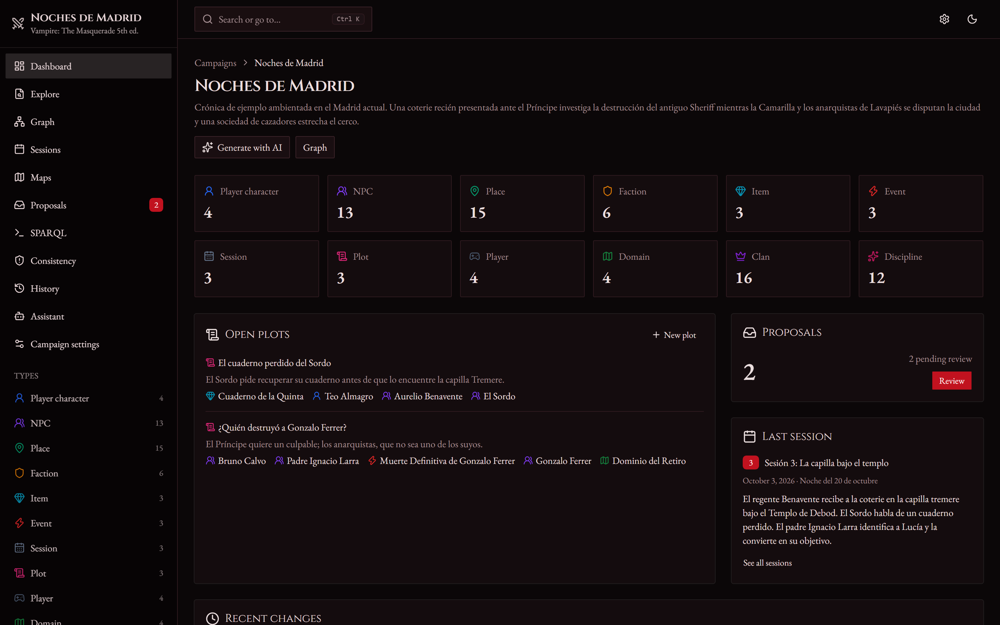
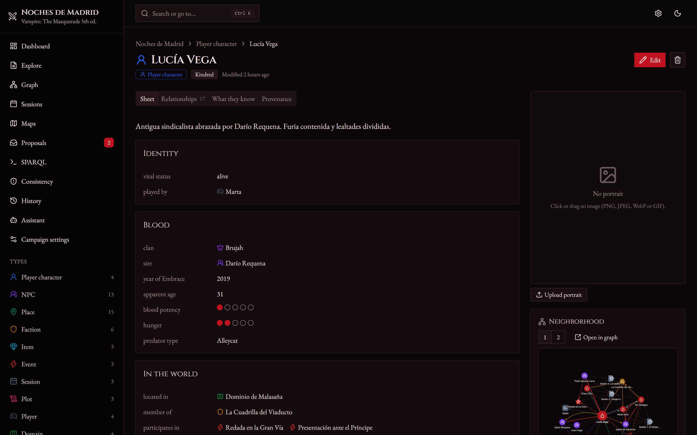
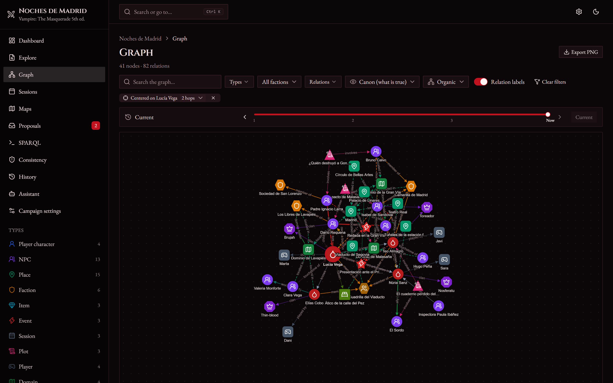
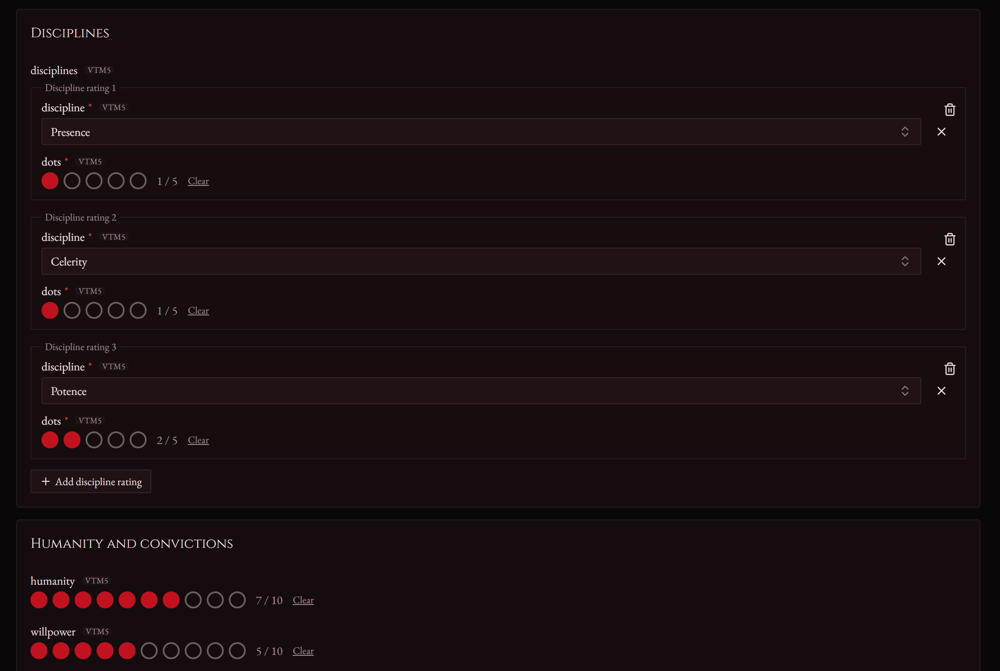
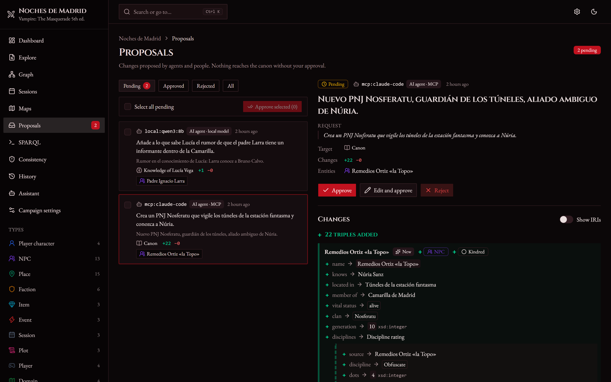
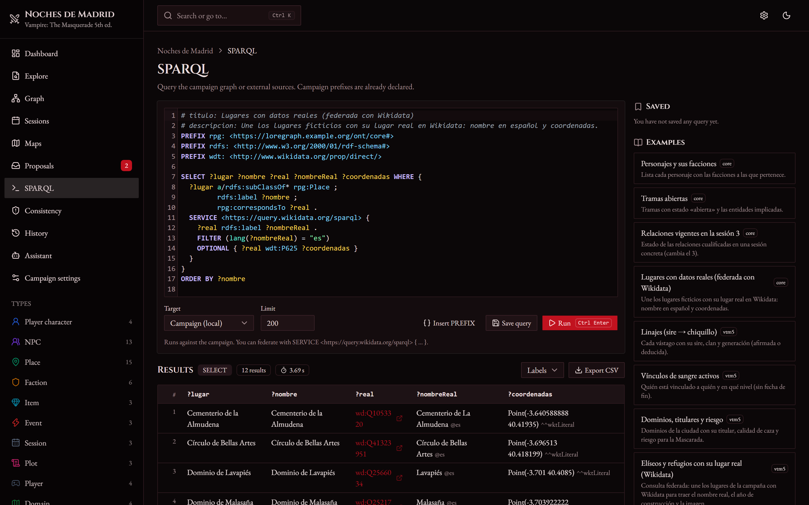

# LoreGraph — Tabletop RPG campaign manager built on knowledge graphs

> **English** · [Español](README.es.md)

Everything in a campaign (player characters, NPCs, places, factions, items, events,
sessions and plots) is stored as an **RDF knowledge graph**. The graph links to open
data (Wikidata, DBpedia) through federated SPARQL, and AI agents can read it and
**propose** changes, which a person always reviews.

The system is modular: a **generic core** plus **one module per game system**. Two are
included: *Vampire: The Masquerade 5th ed.* (unofficial) and *D&D 5e* (SRD 5.1). Adding
a module does not require touching the backend or frontend code.

| | |
|---|---|
|  |  |
|  |  |
|  |  |

The interface is available in English and Spanish. The example campaign's content
(names, descriptions) is written in Spanish because it is set in Madrid.

## Quick start

Requirements: **Python 3.12**, [uv](https://docs.astral.sh/uv/) and **Node.js 20+**.
`make` is optional: `python tasks.py <task>` does the same on Linux, macOS and Windows.

```bash
cp .env.example .env        # on Windows: copy .env.example .env
make install                # or: python tasks.py install
make seed                   # loads "Noches de Madrid" (Vampire) and "La Costa de Ceniza" (D&D)
make dev                    # API on :8765 and the UI at http://localhost:5173
```

| Task | What it does |
|---|---|
| `make install` | `uv sync` (backend) and `npm install` (frontend) |
| `make dev` | Starts backend and frontend together (Ctrl+C stops both) |
| `make test` | pytest + TypeScript type check + Vitest |
| `make seed` | Loads the modules' example campaigns (stop the backend first) |
| `make types` | Regenerates `openapi.json` and the client's TypeScript types |
| `make lint` | Ruff and oxlint/tsc |

> The RDF store (RocksDB) allows **only one process at a time**. Stop the backend
> before running `make seed`.

Startup configuration lives in `.env`, documented in [`.env.example`](.env.example):
data paths, ports, external SPARQL endpoints, timeouts, the User-Agent for Wikidata
and the assistant's local model.

The most common settings can be changed on the **Settings** page (gear icon in the header):
- The language model, with a button to test the connection and list available models.
- Your name.
- Wikidata and DBpedia options.
- SPARQL limits.

These values are stored in `data/aux.sqlite`, separate from the RDF store, and take
precedence over `.env`. Each one can be reset to its original value.

## Features

- **Core `rpg:` ontology** in English, with labels and comments in English and Spanish
  ([core.ttl](backend/src/loregraph/ontology/core.ttl)). It reuses schema.org, FOAF,
  SKOS, PROV-O and OWL-Time.
- **Named graphs** per campaign:
  - `canon`: the approved world.
  - `derived`: what the rules infer.
  - `provenance`: who changed what, when and with which request (PROV-O).
  - `proposals/<id>`: what agents propose.
  - `knowledge/<character>`: what each character believes they know.
- **Qualified relationships** with type, strength and validity by session. The graph
  view can show the world at any session.
- **Full temporality**: when an entity's location, faction, possessions or status
  change, the history is kept by session. The sheet shows where it was and with whom
  at each point.
- **Inconsistency detector**: SPARQL checks from the core and from each module (a dead
  character who reappears, an item with two owners, an impossible vampire generation…).
  Intentional ones can be marked as ignored.
- **History with undo**: every change has provenance and can be undone (refused if a
  later change touched the same data).
- **Portraits and custom maps**: uploaded images with provenance; maps (a city plan, a
  dungeon…) with markers linked to entities.
- **Campaign export and import** as a ZIP (graphs, images, settings and saved
  queries), under the same id or a new one to duplicate a campaign.
- **Forms generated from SHACL**. The frontend renders them without knowing the module:
  types, cardinality, `sh:in`, references, grouping, dots and nested sub-forms. SHACL
  errors from the server appear next to each field.
- **Epistemic view**: the world as a character knows it. Their beliefs are marked as
  confirmed, false (contradicting the canon) or unverified.
- **Real world**: anchors to Wikidata/DBpedia with `rpg:inspiredBy` /
  `rpg:correspondsTo`, **never `owl:sameAs`** (a SHACL shape forbids it). The sheet shows
  the description, image, map (Leaflet + OpenStreetMap) and key facts, kept apart from
  the campaign data.
- **Agents**:
  - **MCP server** at `http://localhost:8765/mcp`, for Claude Code, Claude Desktop or
    other MCP clients.
  - **Built-in assistant** using PydanticAI and **local models** (Ollama by default).
  - **AI generator**: creates NPCs, places, items… with their own backstory and sheets
    that are always valid for the game system (see below).
  - **Campaign lore** (premise, tone, house rules, topics to avoid) added to the
    context of every model.
  - In every case agents only create proposals, which you approve, reject or edit in
    the inbox.
- **Interface**:
  - React + strict TypeScript, Tailwind + shadcn/ui.
  - **Ctrl/Cmd+K** command palette, light/dark mode and a visual theme per module.
  - Responsive (tablet included) and translated (English and Spanish).

## Federated SPARQL example

In the SPARQL editor (target "local"), with the "Noches de Madrid" campaign. The
campaign prefixes are already declared:

```sparql
PREFIX wdt: <http://www.wikidata.org/prop/direct/>

SELECT ?place ?name ?realName ?inception ?image WHERE {
  ?place rdfs:label ?name ;
         rpg:correspondsTo ?real .
  SERVICE <https://query.wikidata.org/sparql> {
    ?real rdfs:label ?realName .
    FILTER (lang(?realName) = "en")
    OPTIONAL { ?real wdt:P571 ?inception }
    OPTIONAL { ?real wdt:P18 ?image }
  }
}
ORDER BY ?name
```

It returns each place in the chronicle (Palacio de Linares, Temple of Debod,
Malasaña…) with its real name, construction date and image from Wikidata.

The backend resolves the federation itself rather than pyoxigraph:
1. It gets the local values of the join variables.
2. It queries the endpoint in batches with `VALUES`, with a timeout, a cache and the
   User-Agent Wikidata requires.
3. It joins the results back together.

Only configured endpoints are allowed. Also available through the API:

```bash
curl -X POST http://localhost:8765/campanas/noches-de-madrid/sparql \
     -H "Content-Type: application/json" \
     -d "{\"consulta\": \"SELECT ?n WHERE { ?x a vtm:Vampire ; rdfs:label ?n }\"}"
```

> The REST API, the MCP tools and the CLI use Spanish identifiers (`campanas`,
> `consulta`, `proponer_triples`…). The OpenAPI documentation is at
> `http://localhost:8765/docs`.

## Agents

### MCP (external agents)

With the backend running, add the server to your MCP client. In Claude Code:

```bash
claude mcp add --transport http loregraph http://localhost:8765/mcp
```

**Tools**

| Purpose | Tools |
|---|---|
| Discover | `listar_campanas`, `listar_tipos`, `esquema_clase`, `leer_instrucciones` |
| Read | `buscar_entidades`, `describir_entidad` |
| Query | `consultar_sparql` (read-only, with a limit), `consultar_mundo_real` (Wikidata/DBpedia) |
| Propose | `proponer_triples` (writes only to the proposals graph, validated with SHACL), `listar_propuestas` |

Each module's `prompts/` are published as MCP prompts. For clients that only speak
stdio, run `uv run loregraph mcp-stdio` (from `backend/`, with the API stopped).

### Local assistant (PydanticAI)

Set `LOREGRAPH_LLM_*` in `.env`. By default it uses Ollama at
`http://localhost:11434/v1` with `qwen3:8b`; any OpenAI-compatible server also works
(LM Studio, llama.cpp, vLLM). Use it from the **Assistant** page or from the terminal:

```bash
uv run --directory backend loregraph agente noches-de-madrid "Create a ghoul servant for Isabel de Sandoval"
```

It is designed for small models:
- It uses high-level tools and compact outputs sized to the context window.
- It proposes changes as structured JSON instead of Turtle.
- If a proposal fails validation, the error goes back to the model to fix it.

### AI generator

`POST /campanas/{id}/generar` (the **Generate with AI** button in Explore and on the
dashboard). The output schema is built at runtime from the class's SHACL shapes:
ranges (e.g. hunger 0–5, generation 3–16), allowed values, cardinality, nested objects
(disciplines, relationships) and references **only** to entities that exist.
PydanticAI enforces that structure, and the sheet then goes through the same SHACL
validation as any proposal; if it fails (or repeats a name), the error goes back to the
model to fix it. The result is saved as a proposal pending review.

`LOREGRAPH_LLM_OUTPUT_MODE` (also in **Settings**) chooses how structured output is
requested: `tool` (tool call, the default), `native` (the provider's JSON Schema, e.g.
Ollama's `format`) or `prompted` (schema in the instructions). If your local model fails
with one, try another.

## Layout

```
backend/   FastAPI API, RDF core (pyoxigraph), SHACL (pySHACL), MCP, agents, tests (pytest)
frontend/  React + Vite + TS, TanStack Query, Cytoscape, CodeMirror, Leaflet, tests (Vitest)
modules/   vtm5/ and dnd5e/: ontology, shapes, vocabulary, rules, queries, checks, prompts, examples
docs/      arquitectura.md (architecture), modulos.md (how to write a module), both in Spanish
```

## Modules

Read [docs/modulos.md](docs/modulos.md) (in Spanish). A module is just a folder in
`modules/` with `manifest.yaml`, `ontology.ttl`, `shapes.ttl`, `vocabulary.ttl`,
`rules/`, `queries/`, `checks/`, `prompts/`, `context.yaml`, `assets/` and `examples/`.

## Licences and notices

- Each installation's data (`data/`) is not part of the repository. To move a campaign
  between installations, use **Export** / **Import**.
- The **Vampire** module is unofficial and contains no text from the rulebooks.
  *Vampire: The Masquerade* is a trademark of Paradox Interactive AB.
- The **D&D 5e** module includes material from the SRD 5.1 by Wizards of the Coast LLC,
  licensed under CC-BY-4.0 (attribution in [modules/dnd5e/README.md](modules/dnd5e/README.md)).
- Maps © OpenStreetMap contributors. Real-world data from Wikidata (CC0) and DBpedia
  (CC-BY-SA).
