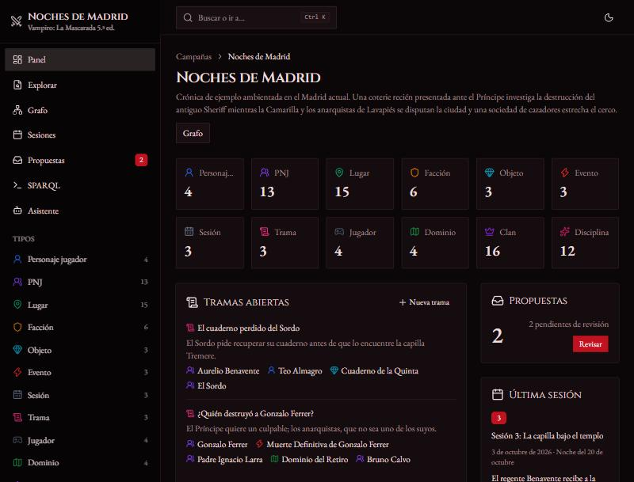
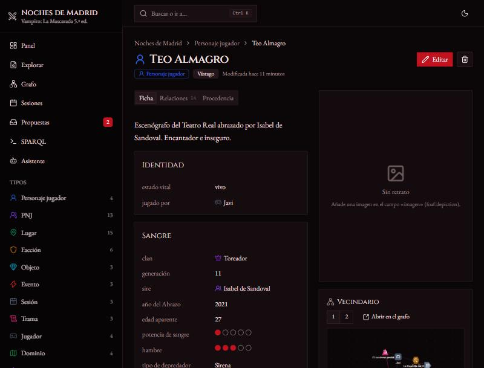
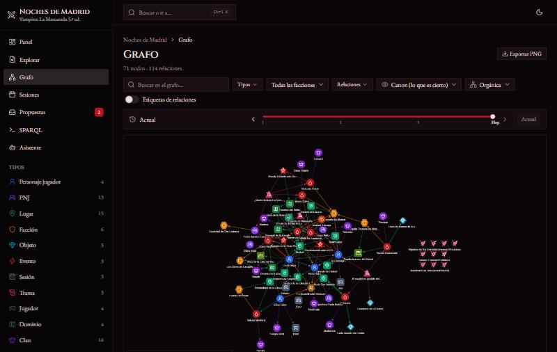
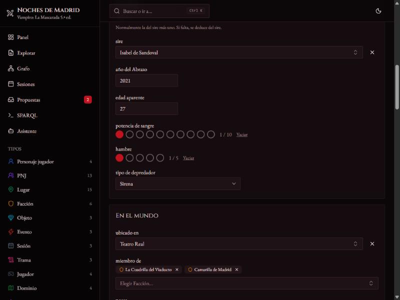

# LoreGraph — Gestor de campañas de rol sobre grafos de conocimiento

Toda la información de una campaña (personajes, PNJ, lugares, facciones, objetos,
eventos, sesiones y tramas) se guarda como **grafo de conocimiento RDF**. El grafo se
enlaza con datos abiertos (Wikidata, DBpedia) mediante SPARQL federado, y los agentes
de IA pueden leerlo y **proponer** cambios, que siempre revisa una persona.

El sistema es modular: un **núcleo genérico** y **módulos por sistema de juego**. Hay
dos incluidos: *Vampiro: La Mascarada 5.ª ed.* (no oficial) y *D&D 5e* (SRD 5.1). Un
módulo no requiere tocar el código del backend ni del frontend.

| | |
|---|---|
|  |  |
|  |  |

## Arranque rápido

Requisitos: **Python 3.12**, [uv](https://docs.astral.sh/uv/) y **Node.js 20+**.
No hace falta `make`: `python tasks.py <tarea>` hace lo mismo en Linux, macOS y Windows.

```bash
cp .env.example .env        # en Windows: copy .env.example .env
make install                # o: python tasks.py install
make seed                   # carga «Noches de Madrid» (Vampiro) y «La Costa de Ceniza» (D&D)
make dev                    # API en :8765 y la interfaz en http://localhost:5173
```

| Tarea | Qué hace |
|---|---|
| `make install` | `uv sync` (backend) y `npm install` (frontend) |
| `make dev` | Arranca backend y frontend en paralelo (Ctrl+C para ambos) |
| `make test` | pytest + comprobación de tipos TypeScript + Vitest |
| `make seed` | Carga las campañas de ejemplo de los módulos (para antes el backend) |
| `make types` | Regenera `openapi.json` y los tipos TypeScript del cliente |
| `make lint` | Ruff y oxlint/tsc |

> El almacén RDF (RocksDB) solo admite **un proceso a la vez**. Para `make seed`, para
> antes el backend.

La configuración de arranque está en `.env`, documentada en [`.env.example`](.env.example):
rutas de datos, puertos, endpoints SPARQL externos, timeouts, User-Agent para Wikidata
y el modelo local del asistente.

Lo más habitual se cambia en la página **Ajustes** (icono de engranaje en la cabecera):
- El modelo de lenguaje, con un botón para probar la conexión y listar los modelos.
- Tu nombre.
- Las opciones de Wikidata y DBpedia.
- Los límites de SPARQL.

Esos valores se guardan en `data/aux.sqlite`, aparte del almacén RDF, y tienen prioridad
sobre `.env`. Cada uno se puede restablecer a su valor original.

## Qué incluye

- **Ontología base `rpg:`** en inglés, con etiquetas y comentarios en español e inglés
  ([core.ttl](backend/src/loregraph/ontology/core.ttl)). Reutiliza schema.org, FOAF, SKOS,
  PROV-O y OWL-Time.
- **Grafos con nombre** por campaña:
  - `canon`: el mundo aprobado.
  - `derived`: lo que deducen las reglas.
  - `provenance`: quién cambió qué, cuándo y con qué petición (PROV-O).
  - `proposals/<id>`: lo que proponen los agentes.
  - `knowledge/<personaje>`: lo que cree saber cada personaje.
- **Relaciones cualificadas** con tipo, intensidad y vigencia por sesión. La vista de
  grafo puede mostrar el mundo en cualquier sesión. Ver
  [docs/arquitectura.md](docs/arquitectura.md).
- **Temporalidad completa**: al cambiar la ubicación, la facción, las posesiones o el
  estado de una entidad, se guarda la historia por sesiones. La ficha muestra dónde
  estuvo y con quién en cada momento.
- **Detector de incoherencias**: comprobaciones SPARQL del núcleo y de cada módulo
  (un muerto que reaparece, un objeto con dos dueños, una generación imposible…).
  Puedes marcar las intencionadas como ignoradas.
- **Historial con deshacer**: cada cambio tiene procedencia y se puede deshacer
  (se rechaza si un cambio posterior tocó los mismos datos).
- **Retratos y mapas propios**: imágenes subidas con procedencia; mapas (plano de la
  ciudad, mazmorra…) con marcadores enlazados a entidades.
- **Exportar e importar campañas** en un ZIP (grafos, imágenes, ajustes y consultas),
  con el mismo id o con otro para duplicarlas.
- **Formularios generados desde SHACL**. El frontend los pinta sin conocer el módulo:
  tipos, cardinalidad, `sh:in`, referencias, agrupación, puntos y subformularios
  anidados. Los errores SHACL del servidor aparecen junto a cada campo.
- **Vista epistémica**: el mundo como lo conoce un personaje. Sus creencias se marcan
  como confirmadas, falsas (contradicen el canon) o sin verificar.
- **Mundo real**: anclas a Wikidata/DBpedia con `rpg:inspiredBy` / `rpg:correspondsTo`,
  **nunca `owl:sameAs`** (una forma SHACL lo impide). La ficha muestra descripción,
  imagen, mapa (Leaflet + OpenStreetMap) y hechos destacados, separados de la campaña.
- **Agentes**:
  - **Servidor MCP** en `http://localhost:8765/mcp`, para Claude Code, Claude Desktop
    u otros clientes MCP.
  - **Asistente interno** con PydanticAI y **modelos locales** (Ollama por defecto).
  - **Generador con IA**: crea PNJ, lugares, objetos… con historia propia y fichas
    siempre válidas para el sistema de juego (ver abajo).
  - **Lore propio de la campaña** (premisa, tono, reglas de la casa, temas a evitar)
    que se añade al contexto de todos los modelos.
  - En todos los casos los agentes solo crean propuestas, y tú las apruebas, rechazas
    o editas en la bandeja.
- **Interfaz**:
  - React + TypeScript estricto, Tailwind + shadcn/ui.
  - Paleta de órdenes **Ctrl/Cmd+K**, modo claro/oscuro y tema visual por módulo.
  - Responsive (pensada también para tablet) e i18n (español e inglés).

## Ejemplo de consulta SPARQL federada

En el editor SPARQL (destino «local»), con la campaña «Noches de Madrid». Los prefijos
de la campaña ya están declarados:

```sparql
PREFIX wdt: <http://www.wikidata.org/prop/direct/>

SELECT ?lugar ?nombre ?nombreReal ?inicio ?imagen WHERE {
  ?lugar rdfs:label ?nombre ;
         rpg:correspondsTo ?real .
  SERVICE <https://query.wikidata.org/sparql> {
    ?real rdfs:label ?nombreReal .
    FILTER (lang(?nombreReal) = "es")
    OPTIONAL { ?real wdt:P571 ?inicio }
    OPTIONAL { ?real wdt:P18 ?imagen }
  }
}
ORDER BY ?nombre
```

Devuelve cada lugar de la crónica (Palacio de Linares, Templo de Debod, Malasaña…) con
su nombre real, fecha de construcción e imagen de Wikidata.

La federación la resuelve el backend, no pyoxigraph:
1. Obtiene los valores locales de las variables de unión.
2. Consulta el endpoint por lotes con `VALUES`, con timeout, caché y el User-Agent que
   exige Wikidata.
3. Vuelve a unir los resultados.

Solo se permiten los endpoints configurados. También por API:

```bash
curl -X POST http://localhost:8765/campanas/noches-de-madrid/sparql \
     -H "Content-Type: application/json" \
     -d "{\"consulta\": \"SELECT ?n WHERE { ?x a vtm:Vampire ; rdfs:label ?n }\"}"
```

## Agentes

### MCP (agentes externos)

Con el backend en marcha, añade el servidor a tu cliente MCP. En Claude Code:

```bash
claude mcp add --transport http loregraph http://localhost:8765/mcp
```

**Herramientas**

| Función | Herramientas |
|---|---|
| Descubrir | `listar_campanas`, `listar_tipos`, `esquema_clase`, `leer_instrucciones` |
| Leer | `buscar_entidades`, `describir_entidad` |
| Consultar | `consultar_sparql` (solo lectura, con límite), `consultar_mundo_real` (Wikidata/DBpedia) |
| Proponer | `proponer_triples` (solo escribe en el grafo de propuestas, validando con SHACL), `listar_propuestas` |

Los `prompts/` de cada módulo se publican como prompts MCP. Para clientes que solo
hablan stdio, `uv run loregraph mcp-stdio` (desde `backend/`, sin la API arrancada).

### Asistente local (PydanticAI)

Configura `LOREGRAPH_LLM_*` en `.env`. Por defecto usa Ollama en `http://localhost:11434/v1`
con `qwen3:8b`; también funciona cualquier servidor compatible con OpenAI (LM Studio,
llama.cpp, vLLM). Úsalo desde la página **Asistente** o desde la terminal:

```bash
uv run --directory backend loregraph agente noches-de-madrid "Crea un sirviente ghoul para Isabel de Sandoval"
```

Está pensado para modelos pequeños:
- Usa herramientas de alto nivel y salidas compactas ajustadas al contexto.
- Propone con JSON estructurado en lugar de Turtle.
- Si la propuesta no valida, el error vuelve al modelo para que la corrija.

### Generador con IA

`POST /campanas/{id}/generar` (botón **Generar con IA** en el explorador). El esquema de
salida se construye en tiempo de ejecución a partir de las formas SHACL de la clase:
rangos (p. ej. hambre 0–5, generación 3–16), valores permitidos, cardinalidad, objetos
anidados (disciplinas, relaciones) y referencias **solo** a entidades que existen.
PydanticAI fuerza esa estructura y, después, la ficha pasa la misma validación SHACL
que cualquier propuesta; si falla (o repite un nombre), el error vuelve al modelo para
que lo corrija. El resultado queda como propuesta pendiente de revisión.

`LOREGRAPH_LLM_OUTPUT_MODE` (también en **Ajustes**) elige cómo se pide la salida
estructurada: `tool` (llamada a herramienta, por defecto), `native` (JSON Schema del
proveedor, p. ej. `format` de Ollama) o `prompted` (esquema en las instrucciones). Si tu
modelo local falla con uno, prueba otro.

## Estructura

```
backend/   API FastAPI, núcleo RDF (pyoxigraph), SHACL (pySHACL), MCP, agentes, tests (pytest)
frontend/  React + Vite + TS, TanStack Query, Cytoscape, CodeMirror, Leaflet, tests (Vitest)
modules/   vtm5/ y dnd5e/: ontología, formas, vocabulario, reglas, consultas, prompts, ejemplos
docs/      arquitectura.md, modulos.md (cómo escribir un módulo)
```

## Módulos

Lee [docs/modulos.md](docs/modulos.md). Basta con una carpeta en `modules/` que tenga:
`manifest.yaml`, `ontology.ttl`, `shapes.ttl`, `vocabulary.ttl`, `rules/`, `queries/`,
`prompts/`, `assets/` y `examples/`.

## Licencias y avisos

- Los datos de cada instalación (`data/`) no se suben al repositorio. Para mover una
  campaña entre instalaciones usa **Exportar** / **Importar**.
- El módulo de **Vampiro** no es oficial y no contiene texto de los manuales.
  *Vampire: The Masquerade* es marca de Paradox Interactive AB.
- El módulo **D&D 5e** incluye material del SRD 5.1 de Wizards of the Coast LLC, con
  licencia CC-BY-4.0 (atribución en [modules/dnd5e/README.md](modules/dnd5e/README.md)).
- Mapas © colaboradores de OpenStreetMap. Datos reales de Wikidata (CC0) y DBpedia
  (CC-BY-SA).
